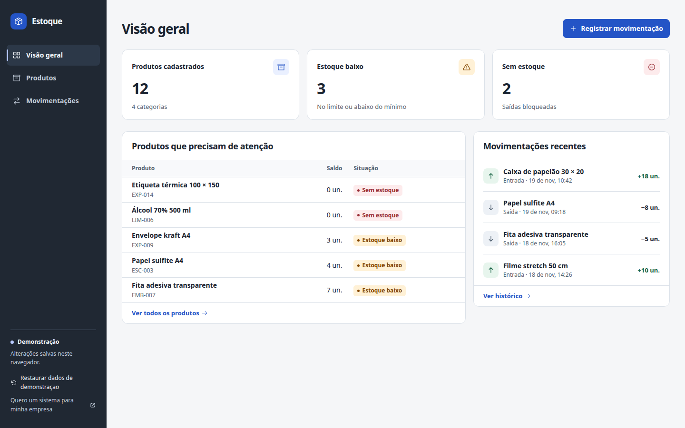

# Gestão de estoque

Demo de um sistema de gestão de estoque feita com **React, TypeScript e Vite**. Você pode cadastrar um produto, registrar uma saída e conferir o saldo atualizado e o histórico de movimentações.

**[Experimentar a demo](https://hericles-koelher.github.io/inventory-demo/)**



## O que você pode testar

- **Visão geral** com indicadores e produtos com saldo baixo ou zerado.
- **Produtos** com cadastro, edição, exclusão, busca por nome ou SKU e filtros por categoria e situação.
- **Movimentações** com entradas, saídas, validação do saldo disponível e histórico.

Para ver a regra de estoque em ação, tente registrar uma saída de **5 unidades de Papel sulfite A4**. O saldo inicial é de 4 unidades e a demo bloqueia a operação. Se registrar uma saída de 4, o produto passa para **Sem estoque** e a movimentação aparece no histórico.

A demo começa com 12 produtos fictícios e funciona sem conta. As alterações são guardadas no `localStorage` do navegador. O botão **Restaurar dados de demonstração** recupera o catálogo e o histórico iniciais.

## Como o projeto é organizado

- [`src/domain`](src/domain) concentra as regras de estoque, os dados de exemplo e a persistência local. O histórico mantém o nome e o SKU registrados mesmo após edição ou exclusão do produto.
- [`src/App.tsx`](src/App.tsx) e [`src/ui`](src/ui) implementam as telas, os formulários compartilhados e a navegação.
- [`DESIGN.md`](DESIGN.md) documenta o sistema visual e o comportamento responsivo.

## Rodar localmente

Na raiz do projeto, com **Node.js 24** e npm, execute os comandos abaixo.

```sh
npm ci
npm run dev
```

| Comando | O que faz |
| --- | --- |
| `npm test` | Executa os testes de regras de estoque e persistência. |
| `npm run build` | Verifica os tipos e gera o build estático em `dist/`. |
| `npm run preview` | Serve o build localmente para conferência. |

## Publicação

O [workflow do GitHub Actions](.github/workflows/pages.yml) roda os testes, gera o build e publica no GitHub Pages a cada push na branch `main`.

O link **Quero um sistema para minha empresa** aponta para [o site do autor](https://hericles-koelher.github.io/). Para usar outro destino, defina `VITE_PORTFOLIO_URL` como variável do repositório no GitHub Actions ou em `.env.local` para desenvolvimento.
